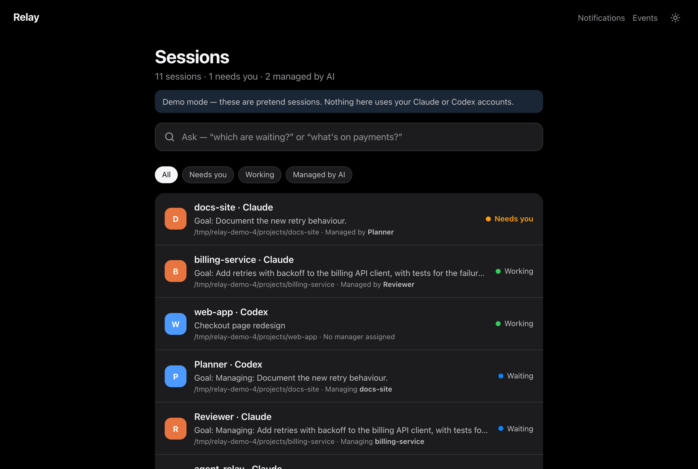
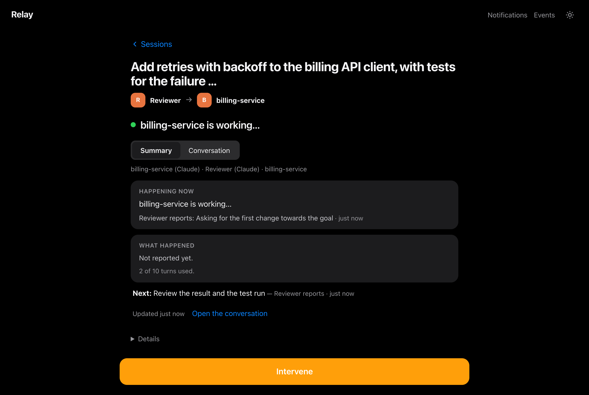
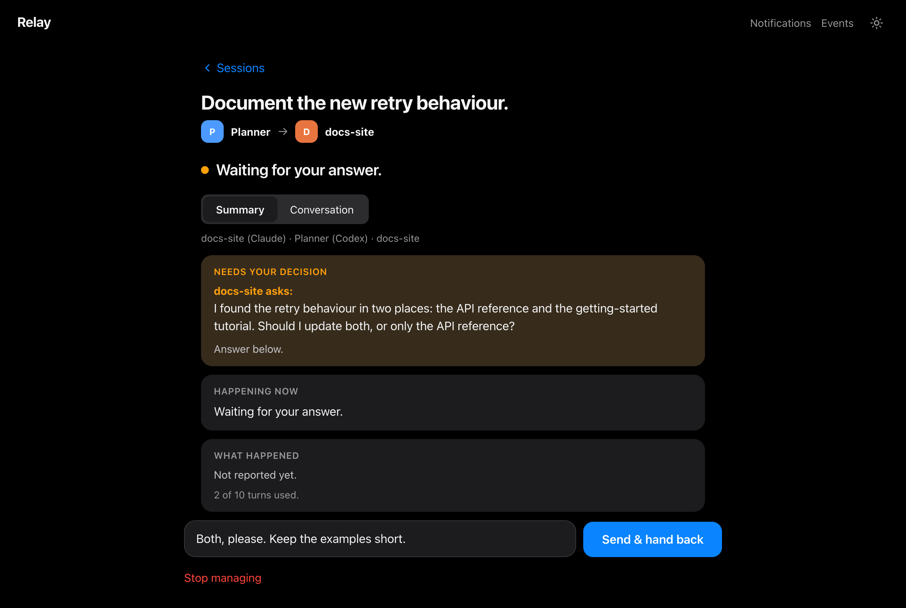

# agent-relay

**Pair two AI coding sessions, with you in control.**

agent-relay passes turns between a **leader** session (by default Codex, which
plans and reviews) and a **follower** session (by default Claude Code, which
implements and reports), so you stop copying text between terminals. It runs in
the foreground on your machine, records every message durably, and stops for you
whenever something needs a human decision.

<picture>
  <source media="(prefers-color-scheme: light)" srcset="docs/images/home-light.png">
  
</picture>

<table>
  <tr>
    <td width="50%"><br><sub><b>Watch:</b> what the managed session is doing, in plain language.</sub></td>
    <td width="50%"><br><sub><b>Decide:</b> questions stop the loop until you answer.</sub></td>
  </tr>
</table>

*Screenshots are from `scripts/console-demo.sh`, which uses pretend sessions. See
the [web console tour](docs/web-console.md) for more.*

- **No dependencies.** Standard-library Python 3.11+. No daemon, database, API
  key or hosted account. The only network listener is the optional web console,
  which binds to loopback.
- **Durable.** Every message is immutable and every state change is an
  append-only, hash-chained event. A crash or restart loses nothing and never
  resumes routing on its own.
- **Human-bounded.** You set the scope, turn budget and timeout. Routing stops for
  review on approval prompts, `ask_human`/`blocked` replies, secret-shaped text,
  malformed output, disconnects or uncertain delivery. Messages that claim to
  carry approval grant nothing.

> **Project status: experimental.** The bus, the controller, the terminal
> console and the web console work end to end with the bundled **fake** clients
> (covered by the Python test suite; the demos use simulated sessions).
> Read-only discovery of running Claude (`claude-agents`) and Codex
> (`codex-local`) sessions works locally.
> The real Claude Code and Codex adapters exist but are **unverified** and are
> refused unless you set `AGENT_RELAY_ALLOW_UNVERIFIED=1`. Claude Code sessions
> that are open in a terminal can be listed, but they can't be driven while open.
> See [docs/INTEGRATION-FEASIBILITY.md](docs/INTEGRATION-FEASIBILITY.md).

## Quick start

No install step is needed. Clone the repository and run it from the checkout.
These commands use fake clients, so they're safe to run anywhere and use no model
quota:

Requirements: macOS (Linux is untested), Python 3.11 or newer. Real sessions also need the
[Claude Code](https://docs.anthropic.com/en/docs/claude-code) and/or
[Codex](https://github.com/openai/codex) CLIs; the demos don't.

```sh
git clone <this-repo> agent-relay && cd agent-relay

# Run the full two-terminal demo in a fresh temporary directory
scripts/walkthrough.sh

# Or open the web console with a few pretend sessions
scripts/console-demo.sh

# Run the test suite
python3 -m unittest discover -s tests -p 'test_*.py'
```

`bin/relay` is a thin wrapper around `python3 -m relay`. Put `bin/` on your
`PATH` to use plain `relay`, or install the `relay` command into your
environment with `pip install .`.

## How it works

```text
   you ──start / pause / answer──┐
                                 ▼
 ┌──────────────┐  handoff  ┌────────────┐  handoff  ┌──────────────┐
 │ leader       │ ◀──────── │ controller │ ────────▶ │ follower     │
 │ (Codex)      │ ────────▶ │ (fg only)  │ ◀──────── │ (Claude)     │
 └──────────────┘  result   └─────┬──────┘  result   └──────────────┘
                                  │
                          durable bus on disk
              messages/ · streams/ (hash-chained) · sessions/ · pairs/
```

1. **Bus** (`relay/storage.py`, `relay/bus.py`): immutable messages, append-only
   event streams and idempotency records under a relay root. It never runs
   message content and never starts a process.
2. **Adapters** (`relay/adapters/`): discover, attach to, launch and submit to
   client sessions. Each capability is an explicit flag, and adapters never
   invent acknowledgments.
3. **Controller** (`relay/controller.py`): binds a pair, keeps exactly one turn in
   flight, enforces the budget and timeout, and stops at every human boundary. It
   runs only while you keep it in the foreground.

Each turn ends with a small machine-readable trailer, which the controller uses to
route it:

````text
```relay
{"relay": 1, "turn_id": "u_…", "action": "continue", "kind": "result", "subject": "one line"}
```
````

The complete specification is in [docs/PROTOCOL.md](docs/PROTOCOL.md).

## Using it

### Terminal console

```sh
export AGENT_RELAY_ROOT=~/relay-root
relay init --participants codex claude
relay console
```

1. **[l] list sessions**: shows what each adapter can see, with its working
   directory, activity and limits.
2. **[a] attach** to an existing session, or **[n] launch** a new one.
3. **[p] create pair**: choose the leader, follower, scope, turn budget (default
   10) and per-turn timeout (default 900 s).
4. **[s] start**: write the first handoff. Routing then runs in the foreground.
5. While it runs, use **p** to pause, **r** to resume, **s** to stop, **t** for
   the thread, **v** for status and **q** to quit.

### Web console

```sh
relay init --participants '*'
relay serve          # prints http://127.0.0.1:<port>/?t=<token>
```

- **Sessions**: every Claude/Codex session the relay can see, each with its
  title, work summary and who is in charge.
- **Manage with AI**: pick a session, choose a manager style (Reviewer, Planner
  or Pair programmer) and give it a goal. The manager leads and your session
  follows.
- **Intervene**: one button that puts you back in control.
- **Loopback only.** The link carries a one-time token, and actions also require
  the page's own origin. `--read-only` turns actions off. Ctrl-C stops the
  console: AI management pauses, sessions the console started close, and your own
  sessions keep running.

Session titles and summaries are descriptive only and never grant control. See
[docs/CONTEXT-REPORTING.md](docs/CONTEXT-REPORTING.md).

### Scriptable CLI

```sh
relay sessions list [--adapter fake|claude-agents|codex-app-server] [--json]
relay sessions attach --adapter <a> --session <client-id> --as codex
relay sessions launch --adapter <a> --cwd <dir> --as claude
relay pair create --leader <endpoint> --follower <endpoint> --scope "..." [--max-turns N] [--turn-timeout S]
relay pair start <pair> --body-file handoff.md --yes
relay pair run <pair> [--exit-on-attention]       # foreground controller
relay pair answer <pair> --body-file answer.md    # answer a question from another terminal
relay pair pause|resume|stop|detach|show <pair>
relay pair extend <pair> --add N
relay pair reconcile <pair> --outcome continue|requeue|drop|route-late --reason "..."
relay status ; relay thread <thread-id> ; relay rebuild
```

Manual mailbox commands are also available: `send`, `inbox`, `read`, `claim`,
`ack`, `reply`, `complete`, `fail`, `release`, `recover`, `pause`, `resume` and
`wait`. Bodies always come from `--body-file` (or `-` for stdin), never from shell
arguments. Add `--json` for machine-readable output.

<details>
<summary>Exit codes</summary>

| Code | Meaning |
|---|---|
| 0 | ok |
| 1 | internal error |
| 2 | usage |
| 3 | not found |
| 4 | conflict (lost race, stale token, idempotency clash, illegal transition) |
| 5 | blocked (paused, stopped, budget) |
| 6 | invalid input or limits |
| 7 | timeout |
| 8 | untrusted history |
| 9 | unsupported by adapter |

</details>

### Participant instructions

[prompts/claude.md](prompts/claude.md) and [prompts/codex.md](prompts/codex.md)
are standalone instructions you can paste into a session that will take part in
a relay.

## Configuration

| Variable | Purpose |
|---|---|
| `AGENT_RELAY_ROOT` | Relay root directory (or pass `--root`). Nothing is created implicitly. |
| `AGENT_RELAY_ALLOW_UNVERIFIED=1` | Allow the unverified real-client adapters. |
| `AGENT_RELAY_FAKE_HOME` | State directory for the fake clients used in demos and tests. |
| `AGENT_RELAY_NOTIFY_CONFIG` | Optional decision-notification settings (webhook or SMS). These are off until configured and verified. |

## Guarantees and limits

- **Durability:** records are published atomically (temp file, `fsync`, `link`,
  then directory `fsync`), and state can be rebuilt from disk at any time.
- **One session, one endpoint:** a client session can be registered only once, so
  two pairs can never drive the same session.
- **Pause** is serialized against dispatch. Work already in flight finishes and
  its result is recorded, but nothing new is sent until you resume.
- **Recovery:** a crash between submission and confirmed acceptance is treated as
  *delivery uncertain*. It's resent only when you explicitly run
  `reconcile --outcome requeue`.
- **Not authentication:** participant labels and leader status are coordination
  conventions. Any process running as the same OS user can write the relay root,
  and the hash chain detects corruption, not a malicious same-user writer. Don't
  use it across users or machines.
- **Not exactly-once:** delivery is at least once, with deduplication where the
  adapter supports it. Completion is a report, not proof.
- **Secret scanning** is a heuristic warning, not a guarantee.

## Repository layout

```text
bin/relay              CLI wrapper (python3 -m relay)
relay/                 the package: storage, bus, protocol, controller, console, CLI
relay/adapters/        fake, Claude Code and Codex session adapters
relay/host.py          web-console service; relay/server.py + relay/web/ serve the page
tests/                 unittest suite (fake clients, temporary roots)
scripts/               demos and bounded live-probe scripts for the real adapters
prompts/               participant instructions for Claude and Codex
docs/                  web console tour, protocol, integration feasibility, context reporting, walkthrough
```

## Documentation

| Document | What it covers |
|---|---|
| [Web console tour](docs/web-console.md) | Every screen of `relay serve`, with screenshots |
| [Walkthrough](docs/WALKTHROUGH.md) | A recorded two-terminal run with real message and turn IDs |
| [Protocol](docs/PROTOCOL.md) | The normative spec: root layout, envelopes, state machines, adapter contract |
| [Integration feasibility](docs/INTEGRATION-FEASIBILITY.md) | What real Claude Code and Codex surfaces can and can't do |
| [Context reporting](docs/CONTEXT-REPORTING.md) | How session titles and summaries are discovered and reported |
| [Roadmap](ROADMAP.md) | What's left before 1.0 and what comes after |
| [Changelog](CHANGELOG.md) | Release notes |

## Contributing

Issues and pull requests are welcome. See [CONTRIBUTING.md](CONTRIBUTING.md)
for the development setup and the rules for changes to the real adapters, and
[SECURITY.md](SECURITY.md) to report a vulnerability privately. This project
follows the [Contributor Covenant](CODE_OF_CONDUCT.md).

## License

[MIT](LICENSE)
