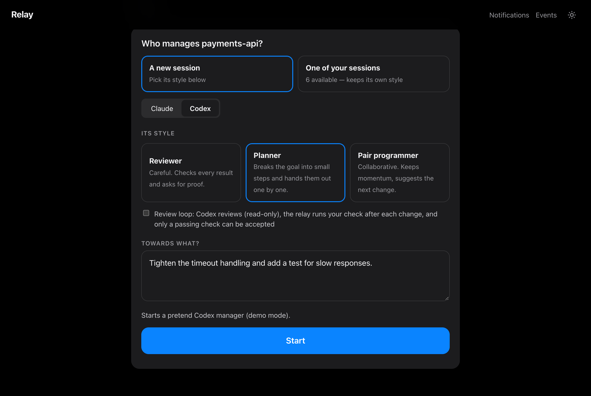
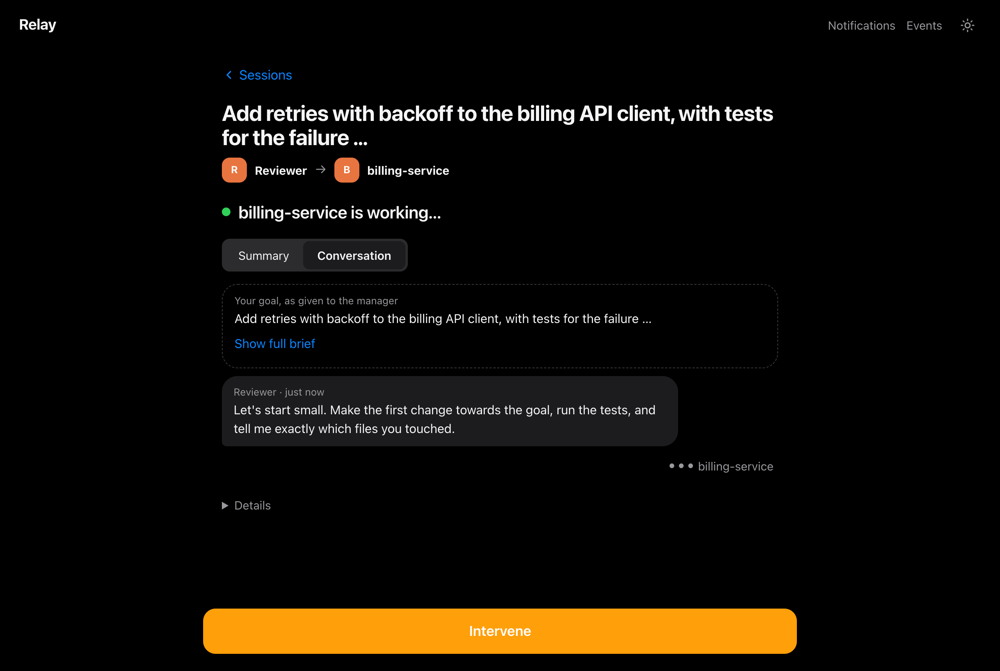
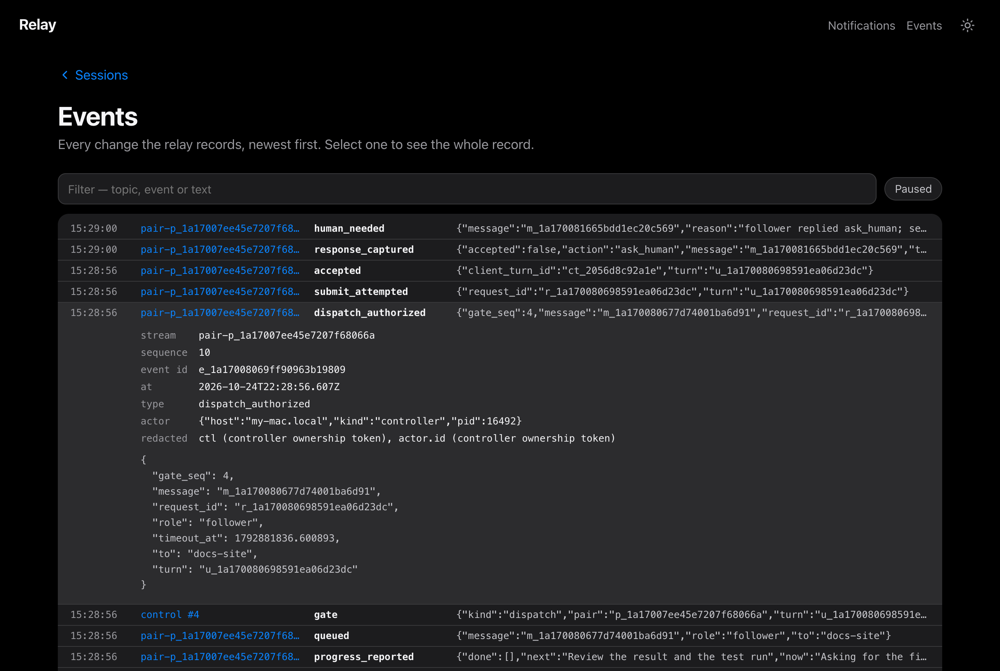
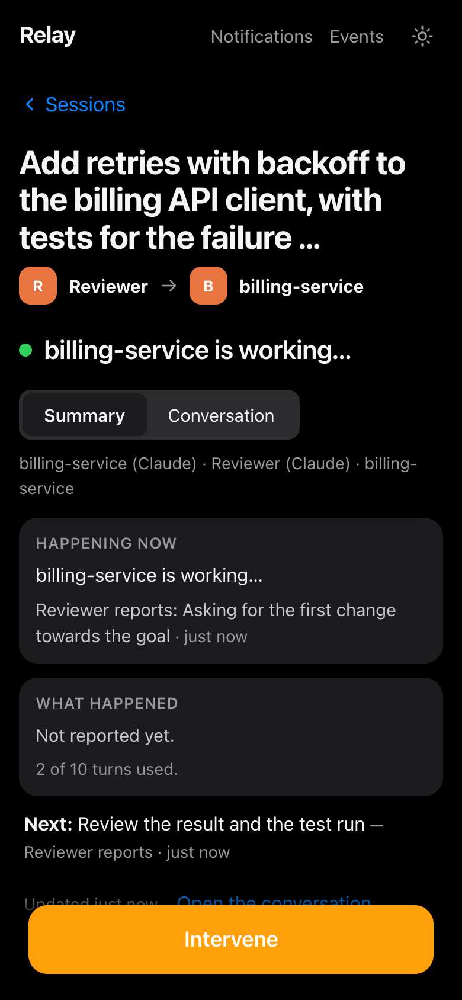

# Web console tour

`relay serve` opens a local web page for watching and steering your Claude Code
and Codex sessions. It binds to `127.0.0.1` only, and the link it prints carries a
one-time token.

```sh
relay init --root ~/relay-root --participants '*'
relay serve --root ~/relay-root        # prints http://127.0.0.1:<port>/?t=<token>
```

To try it without real sessions or model usage:

```sh
scripts/console-demo.sh                # pretend sessions; prints the console link
```

Every screenshot on this page comes from that demo. The console says "Demo mode"
whenever it's running pretend sessions.

## Sessions

<picture>
  <source media="(prefers-color-scheme: light)" srcset="images/home-light.png">
  
</picture>

The home page lists every session the relay can see, shown as *folder · client*.
Each row shows:

- **What it's working on.** This is the work summary, or the conversation's
  title, or a managed goal. Titles and summaries are descriptive only and never
  grant control. See [CONTEXT-REPORTING.md](CONTEXT-REPORTING.md).
- **Who's in charge:** you, an AI manager ("Managed by Reviewer"), or nobody.
- **Its state:** *Needs you*, *Working*, *Waiting* or *Idle*.

Type a question in the box to filter, such as "which are waiting?" or "what's on
payments?". Use the chips to narrow the list to sessions that need you, are
working, or are managed by AI.

## Manage with AI



Open a session and choose **Manage with AI**:

1. **Pick a manager.** It can be **a new session** (Claude or Codex) with a
   style, or **one of your sessions**, which keeps its own style.
   - **Reviewer:** checks every result and asks for proof.
   - **Planner:** breaks the goal into small steps and hands them out one by one.
   - **Pair programmer:** keeps momentum and suggests the next change.
2. **Optionally turn on the review loop.** Codex reviews read-only, the relay runs
   your check command after each change, and only a passing check can be
   accepted.
3. **Say what the goal is**, then press **Start**. The manager leads and your
   session follows, within the turn budget.

## Watch


The **Summary** tab answers three questions: what's happening now, what has
happened so far, and what's next. Progress lines are attributed to whoever
reported them ("Reviewer reports …"), and the turn budget is always visible.



The **Conversation** tab shows the full exchange: your goal as given to the
manager, each instruction and each result.

## Decide


When either side replies `ask_human`, routing stops and the session moves to the
top of the list as *Needs you*. The question is shown word for word, with the
name of whoever asked it.

- **Send & hand back** answers the question and lets the manager continue.
- **Stop managing** ends AI management. Your session keeps running.

**Intervene** is always available while a session is managed. It puts you in
control immediately: the turn in flight finishes and its result is kept, nothing
new is sent, and you can say something, hand back or stop.

## Events



**Events** shows every record the relay writes, newest first. Select a row to see
the whole record: its stream, sequence number, actor, and the fields that were
redacted. Controller ownership tokens are never shown. Use **Live** / **Paused**
to freeze the list while you read.

> The machine name in this screenshot's `actor.host` field was replaced with
> `my-mac.local` before publishing. The console itself shows your real host name.

## On a phone



The layout works down to phone width. Because the console is loopback-only, you'll
only see it on a phone through your own tunnel or port forward. The relay doesn't
provide one.

## Notifications

Under **Notifications**, you can have the relay alert you when a session needs a
decision, through a webhook or SMS. It's off by default. Each destination must be
verified with a code before it can be turned on, and messages carry the kind of
decision, not code or transcripts.

## Regenerating these screenshots

```sh
DEMO=/tmp/relay-demo scripts/console-demo.sh     # terminal 1; note the printed link
node scripts/screenshots.mjs '<link>' docs/images
```

The script needs Node 22 and Google Chrome. It only opens screens and types into
them; it never submits anything. Run it soon after the demo starts, while the
pretend billing-service team is still working.
